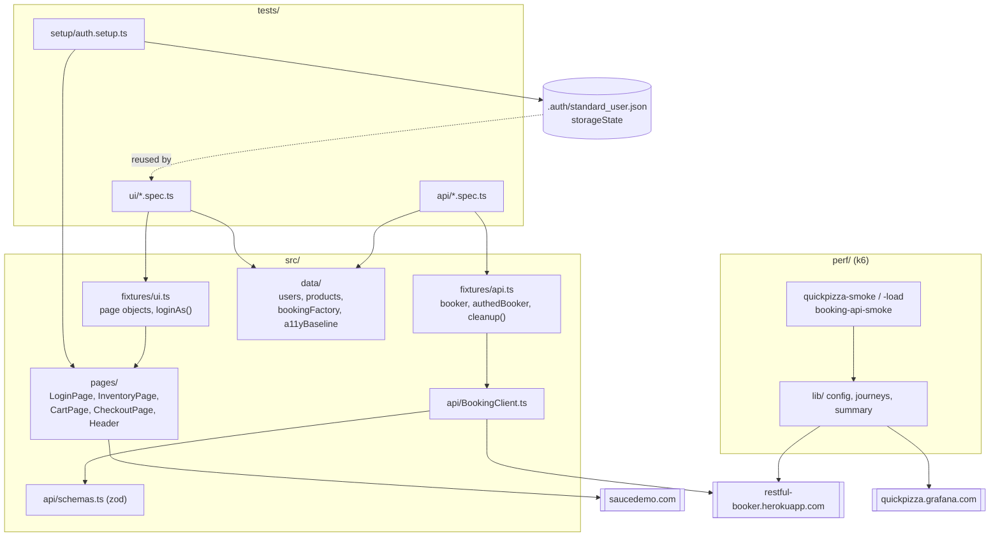
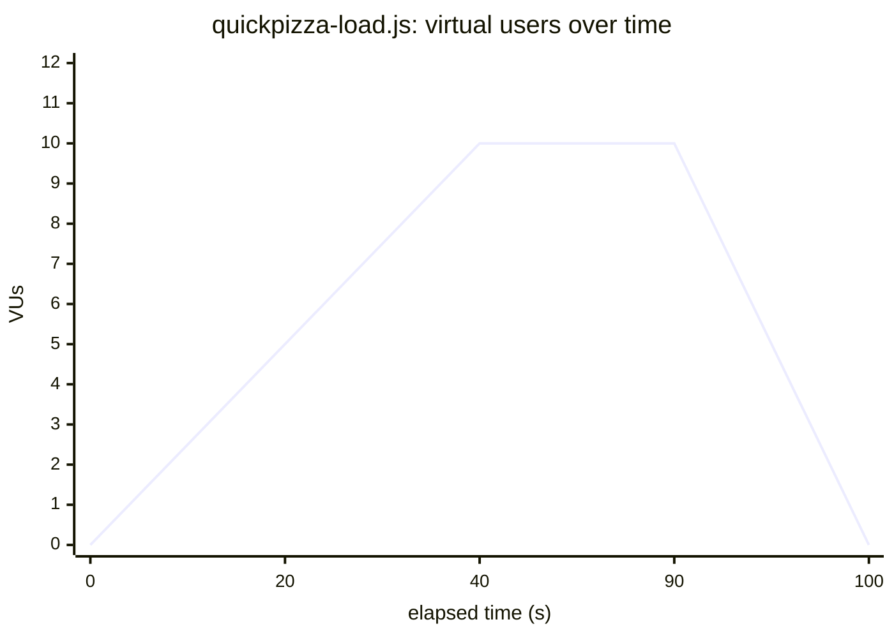
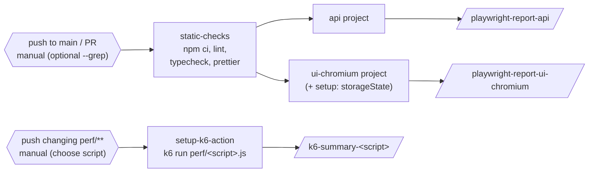

# playwright-k6-quality-suite

[](https://github.com/fathirwafda/playwright-k6-quality-suite/actions/workflows/playwright.yml)
[](https://github.com/fathirwafda/playwright-k6-quality-suite/actions/workflows/k6.yml)


A test automation suite that covers three layers of quality against public demo targets:
**UI end-to-end** tests (Playwright, Page Object Model) for an online store, **API** contract and
behaviour tests (Playwright request context, zod schemas) for a booking service, and **performance**
tests (k6) with thresholds wired into CI. Everything runs from a fresh clone with two commands, and
every target is a public demo site, so anyone can reproduce the results.

## Contents

- [Tech stack](#tech-stack)
- [Architecture](#architecture)
- [Test coverage](#test-coverage)
- [Project structure](#project-structure)
- [Quick start](#quick-start)
- [Configuration](#configuration)
- [Performance tests (k6)](#performance-tests-k6)
- [CI pipeline](#ci-pipeline)
- [Reporting](#reporting)
- [Design decisions](#design-decisions)
- [Known issues found on the demo sites](#known-issues-found-on-the-demo-sites)
- [Roadmap](#roadmap)
- [License](#license)

## Tech stack

| Area           | Tools                                                                           |
| -------------- | ------------------------------------------------------------------------------- |
| Language       | TypeScript (strict, `noUncheckedIndexedAccess`)                                 |
| UI + API tests | `@playwright/test`                                                              |
| Schemas        | `zod`                                                                           |
| Test data      | `@faker-js/faker`                                                               |
| Accessibility  | `@axe-core/playwright` (WCAG 2.1 A/AA + best-practice rules)                    |
| Performance    | k6                                                                              |
| Code quality   | ESLint (flat config, `typescript-eslint`, `eslint-plugin-playwright`), Prettier |
| CI             | GitHub Actions                                                                  |

**Targets** (all public demo sites):

| Target                                                 | Used for                  |
| ------------------------------------------------------ | ------------------------- |
| [Sauce Demo](https://www.saucedemo.com)                | UI tests                  |
| [Restful Booker](https://restful-booker.herokuapp.com) | API tests, small k6 smoke |
| [QuickPizza](https://quickpizza.grafana.com)           | k6 smoke and load tests   |

## Architecture

Specs only talk to fixtures. Fixtures build page objects and API clients; those are the only code
that knows about selectors, URLs and payload shapes.



## Test coverage

| Feature                                         | UI (Playwright) | API (Playwright) | Accessibility | Performance (k6) |
| ----------------------------------------------- | :-------------: | :--------------: | :-----------: | :--------------: |
| Login: success, logout, redirect                |       ✅        |                  |      ✅       |                  |
| Login: locked user, bad password, empty fields  |       ✅        |                  |               |                  |
| Inventory sorting (name, price)                 |       ✅        |                  |      ✅       |                  |
| Cart add / remove / persistence                 |       ✅        |                  |               |                  |
| Checkout flow, totals, validation               |       ✅        |                  |               |                  |
| Known defect: `problem_user` images             |       ✅        |                  |               |                  |
| Visual snapshots (opt-in)                       |       ⚪        |                  |               |                  |
| Health check (`/ping`)                          |                 |        ✅        |               |        ✅        |
| Auth token (valid, invalid)                     |                 |        ✅        |               |                  |
| Booking create / read / PUT / PATCH / delete    |                 |        ✅        |               |                  |
| Booking authorisation (403) and not found (404) |                 |        ✅        |               |                  |
| Booking invalid payloads                        |                 |        ✅        |               |                  |
| Booking filter by name                          |                 |        ✅        |               |                  |
| Booking list under light load                   |                 |                  |               |        ✅        |
| Pizza recommendation journey                    |                 |                  |               |        ✅        |

✅ automated and run in CI · ⚪ present but opt-in (see [visual tests](#visual-snapshot-tests))

Current size: 17 API tests, 23 UI tests (plus 2 opt-in visual tests and 1 login setup step), 3 k6 scripts.

## Project structure

```text
.
├── .github/workflows/
│   ├── playwright.yml        # lint, typecheck, api + ui-chromium; push/PR/manual
│   └── k6.yml                # k6 smoke/load; perf changes/manual
├── perf/
│   ├── lib/
│   │   ├── config.js         # base URLs, shared thresholds
│   │   ├── quickpizza.js     # user journey + checks
│   │   └── summary.js        # handleSummary -> perf/results/*.json|txt
│   ├── quickpizza-smoke.js
│   ├── quickpizza-load.js
│   ├── booking-api-smoke.js
│   └── results/              # gitignored run output
├── src/
│   ├── api/                  # BookingClient + zod schemas
│   ├── data/                 # users, products, booking factory, a11y baseline
│   ├── fixtures/             # ui.ts, api.ts (test.extend)
│   ├── pages/                # page objects
│   └── utils/                # env loading, sort helpers
├── tests/
│   ├── api/                  # health-auth, booking-crud, booking-negative
│   ├── setup/                # auth.setup.ts (storageState)
│   └── ui/                   # login, sorting, cart, checkout, a11y, known issues, visual
├── playwright.config.ts
├── eslint.config.mjs
└── tsconfig.json
```

## Quick start

Requirements: Node.js 20 or newer (`.nvmrc` pins 20), and k6 for the performance tests only.

```bash
npm ci                                    # or: npm install
npx playwright install --with-deps chromium

npm test                                  # every project (api, ui-chromium, ui-firefox, ui-webkit)
npm run test:api                          # API tests only
npm run test:ui                           # UI tests on Chromium
npm run test:smoke                        # @smoke-tagged tests, api + chromium
npm run test:a11y                         # accessibility checks
npm run report                            # open the last HTML report

npm run lint && npm run typecheck         # static checks
```

`npm test` runs Firefox and WebKit too; install them first with
`npx playwright install --with-deps firefox webkit`. CI runs `api` and `ui-chromium`.

Filter by tag with Playwright's `--grep`, for example `npx playwright test --grep "@regression"`
or `--grep-invert "@known-issue"`.

### k6

```bash
brew install k6          # macOS; other platforms: https://grafana.com/docs/k6/latest/set-up/install-k6/

npm run perf:smoke       # QuickPizza, 1 VU, 30s
npm run perf:load        # QuickPizza, ramping to 10 VUs, ~1m40s
npm run perf:load:short  # same shape and thresholds, 5 VUs, ~40s
npm run perf:booking     # Restful Booker, 2 VUs, 30s, read-only
```

Run k6 from the repo root so summaries land in `perf/results/`. The scripts were written and run
with k6 v2.3.0.

## Configuration

All settings have defaults, so a `.env` file is optional. To override, create a local `.env` (gitignored)
with any of the variables below.

| Variable              | Default                                | Used by                            |
| --------------------- | -------------------------------------- | ---------------------------------- |
| `UI_BASE_URL`         | `https://www.saucedemo.com`            | UI tests                           |
| `API_BASE_URL`        | `https://restful-booker.herokuapp.com` | API tests                          |
| `SAUCE_USERNAME`      | `standard_user`                        | UI login/setup                     |
| `SAUCE_PASSWORD`      | `secret_sauce`                         | UI login/setup                     |
| `BOOKER_USERNAME`     | `admin`                                | API auth                           |
| `BOOKER_PASSWORD`     | `password123`                          | API auth                           |
| `VISUAL`              | unset                                  | `1` enables visual snapshot tests  |
| `CI`                  | unset                                  | retries 2, 2 workers, `forbidOnly` |
| `QUICKPIZZA_BASE_URL` | `https://quickpizza.grafana.com`       | k6 (`-e` or env)                   |
| `QUICKPIZZA_TOKEN`    | `abcdef0123456789`                     | k6                                 |
| `BOOKER_BASE_URL`     | `https://restful-booker.herokuapp.com` | k6                                 |

The credentials above are the public demo accounts each site publishes on its own login page or
API docs. They are not secrets.

## Performance tests (k6)

The scripts are plain ES modules for the k6 runtime: no Node APIs, shared code in `perf/lib/`.
Each script exports `handleSummary`, which prints the normal summary and writes
`perf/results/<script>.json` and `.txt` for CI artifacts.

The load profile is deliberately small, because QuickPizza is a shared public demo:



| Stage     | Duration | Target VUs |
| --------- | -------- | ---------- |
| Warm up   | 20s      | 5          |
| Ramp      | 20s      | 10         |
| Steady    | 50s      | 10         |
| Ramp down | 10s      | 0          |

Two env vars scale the profile without changing its shape or thresholds: `PEAK_VUS` (capped at 10)
and `STAGE_SCALE` (multiplies every stage duration). For example,
`k6 run -e PEAK_VUS=5 -e STAGE_SCALE=0.4 perf/quickpizza-load.js` runs 8s / 8s / 20s / 4s with
3 then 5 VUs. This is what `npm run perf:load:short` does.

Thresholds (the run fails if any is breached):

| Metric                                    | Threshold                       | Scripts       |
| ----------------------------------------- | ------------------------------- | ------------- |
| `http_req_failed`                         | rate < 1%                       | all           |
| `checks`                                  | rate > 99%                      | all           |
| `http_req_duration`                       | p(95) < 800 ms                  | QuickPizza    |
| `http_req_duration{name:POST /api/pizza}` | p(95) < 800 ms, p(99) < 1500 ms | load          |
| `http_req_duration`                       | p(95) < 1500 ms (cold starts)   | booking smoke |

The load test aborts early if the error rate goes above 1% after the first 20 seconds (scaled by
`STAGE_SCALE`), so a struggling target is not hammered for the full run. The booking smoke is
read-only and creates no data.

Sample run (10 November 2026, k6 v2.3.0, from a laptop; one run each, so treat it as
an example, not a benchmark):

| Script                               | Requests | Failed | Checks | p(95) `http_req_duration`          |
| ------------------------------------ | -------- | ------ | ------ | ---------------------------------- |
| `quickpizza-smoke` (1 VU, 30s)       | 38       | 0%     | 100%   | 355 ms                             |
| `quickpizza-load` short (5 VUs, 40s) | 144      | 0%     | 100%   | 378 ms (`POST /api/pizza`: 381 ms) |
| `booking-api-smoke` (2 VUs, 30s)     | 68       | 0%     | 100%   | 523 ms                             |

Latency is measured from wherever k6 runs (a laptop or a GitHub runner) to a public host over the
internet. The thresholds are a sanity budget for that setup, not a statement about the target's
real capacity.

## CI pipeline



- `playwright.yml`: the two test projects run as a matrix with `fail-fast: false`, so an API outage
  does not hide UI results. Reports upload even when tests fail. A newer push cancels an older run
  on the same branch.
- `k6.yml`: runs the smoke script on pushes to `main` that change `perf/**`; a manual run can
  pick any of the three. There are no scheduled runs.
- Action major versions are pinned (`actions/checkout@v4`, `actions/setup-node@v4`,
  `actions/upload-artifact@v4`, `grafana/setup-k6-action@v1`).

## Reporting

- **Terminal**: `list` reporter.
- **HTML report**: `playwright-report/`, opened with `npm run report`; uploaded as a CI artifact.
- **On failure**: screenshot and video kept; a trace is recorded on the first retry (CI retries twice).
- **Accessibility**: each a11y test attaches `axe-results.json` and adds one annotation per violation
  (impact, rule id, node count), visible in the HTML report.
- **Known issues**: tests that document a defect carry a `known-issue` annotation.
- **k6**: stdout summary plus `perf/results/<script>.json|txt`.

## Design decisions

**Page Object Model with assertion helpers.** Selectors live in one place per page, so a markup
change is a one-line fix. Page objects expose intent (`addToCart`, `fillInformation`) and a few
`expect*` helpers for checks that every caller would otherwise repeat. Business assertions stay in
the spec, where a reader expects them.

**Fixtures instead of `beforeEach` plumbing.** `test.extend` gives each test its page objects and API
clients, and `cleanup()` registers bookings for deletion after the test whatever its outcome.

**`storageState` login.** A setup project logs in once and saves the session; UI tests start already
logged in. Login itself is tested in its own spec, with an empty storage state. Tests that need a
different user (`problem_user`) use the `loginAs` fixture, which clears cookies first.

**zod for API contracts.** Every typed client call validates the response body against a schema.
That catches contract drift (a renamed field, a number that became a string) that status-code
checks miss, and the same schemas give the TypeScript types, so the types cannot drift from the
checks. Negative tests use `raw*` methods that return the raw response.

**Test data factory.** `buildBooking()` creates valid, unique bookings with faker and accepts
overrides. A random suffix on names lets the filter test find exactly its own booking on a shared
public API.

**Tagging.** Tags are in test titles so `--grep` works without custom config:
`@smoke` (fast, critical path, a few per area), `@regression` (everything else), `@api` / `@ui`
(layer), `@a11y`, `@visual`, `@known-issue`.

**Flakiness strategy.**

- Web-first assertions (`toHaveText`, `toHaveURL`, `expect.poll`) instead of fixed sleeps.
- Stable selectors: the site's `data-test` attributes (`testIdAttribute: 'data-test'`) and roles.
- Isolated state: each test gets a fresh browser context; API tests create their own data and
  clean it up.
- Retries only in CI (2), with traces on the first retry, so a flaky test shows up as "flaky" in the
  report instead of being hidden.
- Third-party quirks are asserted explicitly and commented (for example `/ping` returning 201)
  instead of loosening assertions.

**Accessibility baseline.** We do not own the demo site, so the a11y tests fail only on
critical/serious violations that are not in `src/data/a11yBaseline.ts`. All violations are still
reported. Today the baseline is empty: axe finds no critical or serious issues on the two pages.

**Known defects as `test.fail()`.** A known-issue test asserts the correct behaviour and is marked
as expected to fail. It passes while the bug exists and turns red when the bug is fixed, so the
documentation cannot go stale.

### Visual snapshot tests

`tests/ui/visual.spec.ts` is skipped unless `VISUAL=1`. Font rendering differs between macOS, Linux
and Windows, so baselines only make sense when they are created and compared on the same OS image.
No baselines are committed. To use them, generate baselines in the Playwright Docker image (the same
one CI would use) with `VISUAL=1 npx playwright test visual --project=ui-chromium --update-snapshots`.

## Known issues found on the demo sites

These are behaviours of the public demo targets, observed while building the suite. Some are
intentional (the sites exist for practice).

| Site           | Behaviour                                                                       | How the suite handles it                                                |
| -------------- | ------------------------------------------------------------------------------- | ----------------------------------------------------------------------- |
| Sauce Demo     | `problem_user` sees the same placeholder image (`sl-404`) for every product     | `test.fail()` known-issue test, plus a `standard_user` control test     |
| Sauce Demo     | No level-one heading on login or inventory; login content not inside a landmark | Reported as moderate a11y findings; not blocking                        |
| Restful Booker | `POST /booking` with a missing or wrong-typed field returns `500`, not `400`    | Negative tests assert a non-2xx response and pin the current `500`      |
| Restful Booker | `/ping` returns `201 Created`; `DELETE` returns `201` on success                | Asserted explicitly, with a comment                                     |
| Restful Booker | Bad credentials on `/auth` return `200` with `{"reason":"Bad credentials"}`     | Validated with a zod schema                                             |
| Restful Booker | Shared public data; the service resets periodically                             | Tests create and delete their own bookings, never rely on existing ones |

## Roadmap

- Run the visual tests inside the Playwright Docker image in CI with committed Linux baselines.
- Add Firefox and WebKit to the CI matrix as a manual-only job.
- Generate the API client types from an OpenAPI spec where a target publishes one.
- Push k6 results to Grafana Cloud k6 or an InfluxDB/Grafana stack for trend dashboards.
- Add a k6 browser test for the QuickPizza front end.
- Shard the UI project once the suite grows past a few minutes.

## License

[MIT](LICENSE)
